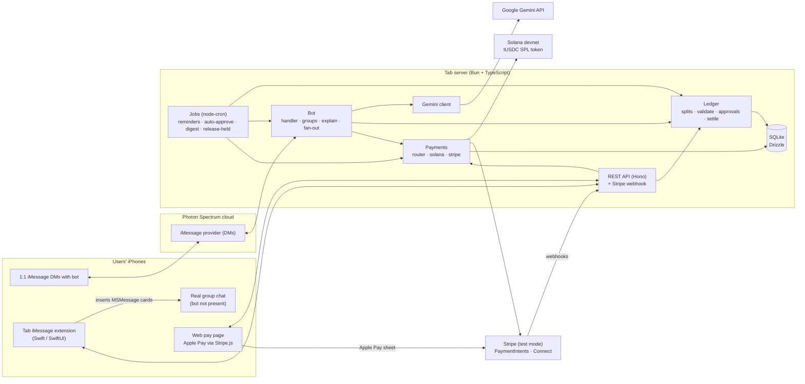
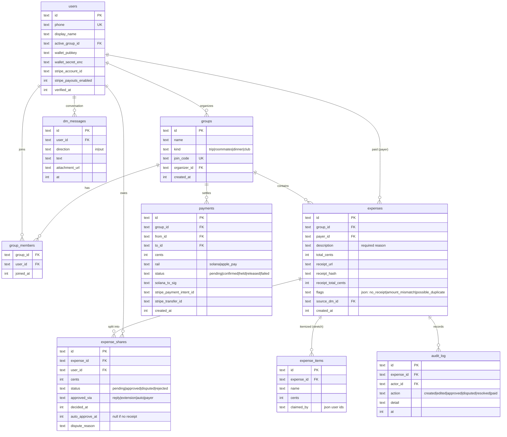
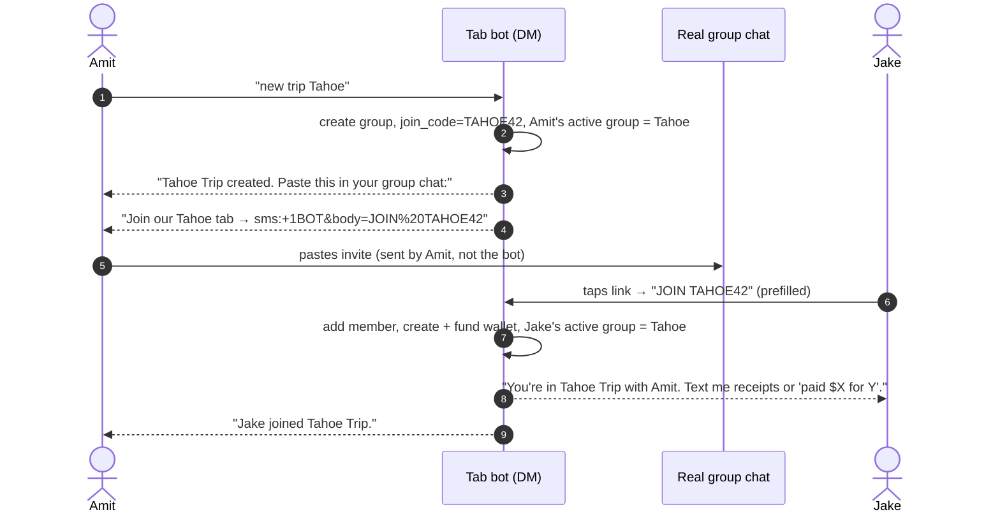
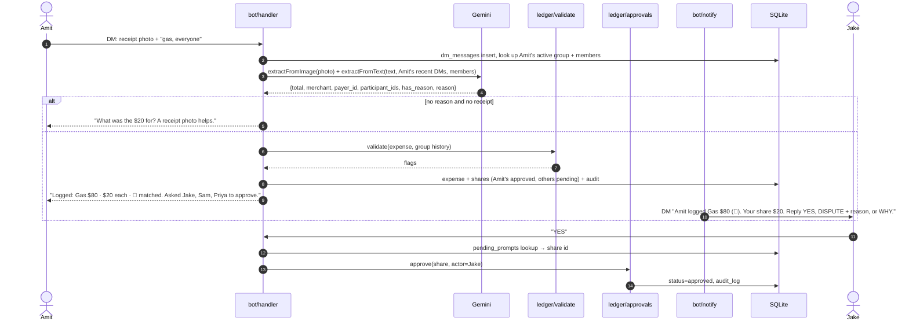
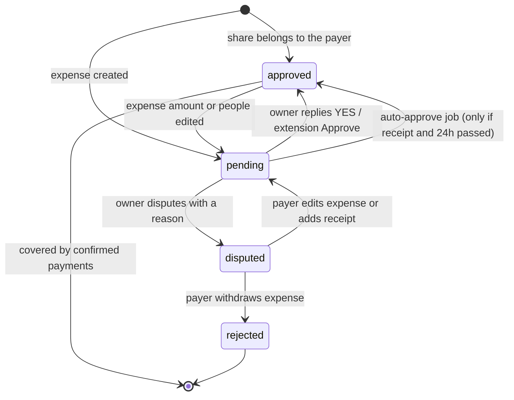
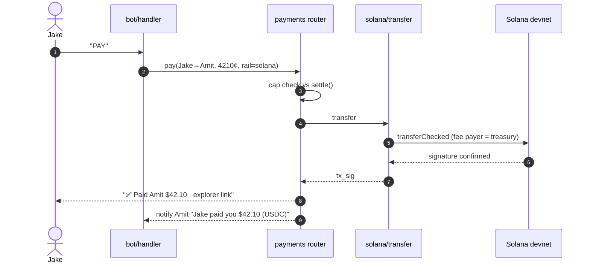
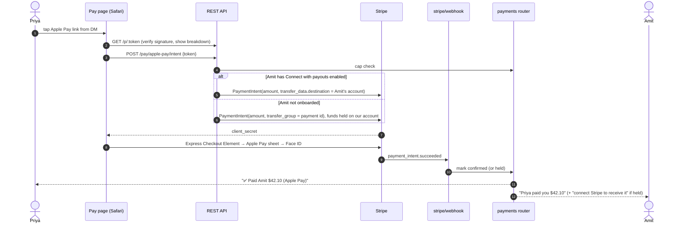
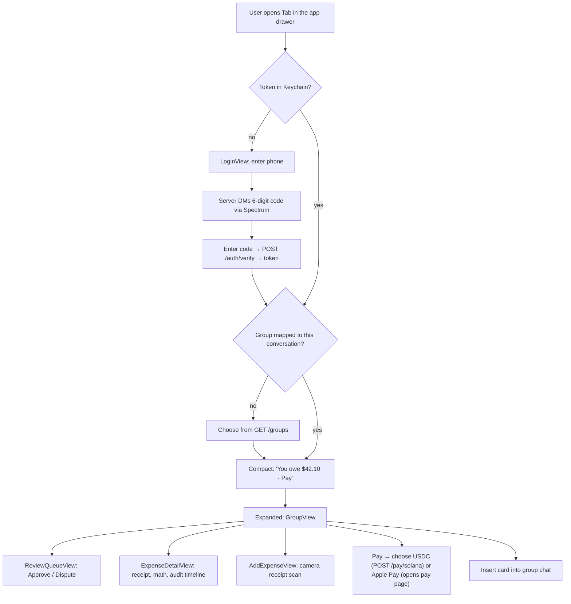

# Tab: Architecture

The product overview, decisions, and timeline are in [PLAN.md](./PLAN.md). This doc covers how the system is built.

**Two constraints shape the design:**
1. **Photon Spectrum, 1:1 DMs only.** Our plan doesn't include group chats, so the bot never sits in a group thread. A "group" is a server-side record that members join by code, and every bot interaction is a direct message.
2. **Two ways to pay, one ledger.** Debts can be settled with **USDC on Solana** (wallets the backend makes and holds) or **Apple Pay via Stripe** (paid out to the creditor in USD through Stripe Connect).

## System overview



| Component | Location | Responsibility |
|---|---|---|
| Spectrum app | `server/src/index.ts` | Boots `Spectrum({ projectId, projectSecret, providers: [imessage.config()] })` and iterates `app.messages` (DMs only). |
| Messaging wrapper | `server/src/messaging.ts` | The only module that imports `spectrum-ts`. Provides `sendDM(userId, text)`, `getAttachment`, `senderPhone`. Applies outbound rate limiting. |
| Bot handler | `server/src/bot/handler.ts` | Routes each DM to a command (`NEW`, `JOIN`, `USE`, `SETTLE`, `PAY`, `WHY`, `YES`, `DISPUTE`), a reply to a pending approval, a possible expense, or help. |
| Groups | `server/src/bot/groups.ts` | Create group, join codes, membership, each user's **active group**. |
| Fan-out | `server/src/bot/notify.ts` | Sends one DM per affected member (approval requests, payment receipts, digests), batched per person. |
| Explain | `server/src/bot/explain.ts` | Answers "why do I owe this?" from ledger records only. |
| Gemini client | `server/src/ai/gemini.ts` | `extractFromText`, `extractFromImage` (receipts *and* chat screenshots), `explainShares`. |
| Ledger | `server/src/ledger/*` | Pure logic: split math, validation flags, the share state machine, debt simplification. |
| Payments router | `server/src/payments/index.ts` | Checks the amount against approved debt, picks the payment method, records `payments`, posts confirmations. |
| Solana | `server/src/payments/solana/*` | Makes wallets, encrypts keys, funds new wallets, sends tUSDC transfers. |
| Stripe | `server/src/payments/stripe/*` | PaymentIntents for Apple Pay, Connect Express onboarding, webhooks, held transfers. |
| Jobs | `server/src/jobs/*` | Reminders, auto-approval, daily digest, releasing held Stripe transfers. |
| REST API | `server/src/api/routes.ts` | Used by the extension and the pay page. Also receives the Stripe webhook. |
| Web | `server/src/web/*` | Pay page (Apple Pay), link-preview image, Apple Pay domain-verification file. |
| iMessage extension | `ios/Tab/MessagesExtension` | In-group-chat UI: cards, balances, approvals, why, Pay, add expense. |

## Repo layout

```
.
├── PLAN.md
├── ARCHITECTURE.md
├── server/
│   ├── package.json
│   ├── drizzle.config.ts
│   ├── .env.example
│   ├── scripts/
│   │   ├── setup-devnet.ts        # treasury keypair, tUSDC mint, SOL airdrop
│   │   └── setup-stripe.ts        # register Apple Pay payment method domain
│   ├── src/
│   │   ├── index.ts               # boot: Spectrum loop + HTTP server + cron
│   │   ├── config.ts              # env parsing (zod)
│   │   ├── messaging.ts           # spectrum-ts wrapper (DMs only)
│   │   ├── bot/
│   │   │   ├── handler.ts
│   │   │   ├── commands.ts        # NEW / JOIN / USE / SETTLE / PAY / WHY / YES / DISPUTE
│   │   │   ├── groups.ts          # create, join codes, active group
│   │   │   ├── notify.ts          # DMs to each person, batching, digest
│   │   │   ├── explain.ts
│   │   │   └── copy.ts            # all user-facing message templates
│   │   ├── ai/
│   │   │   ├── gemini.ts
│   │   │   └── schemas.ts
│   │   ├── ledger/
│   │   │   ├── splits.ts
│   │   │   ├── validate.ts
│   │   │   ├── approvals.ts
│   │   │   └── settle.ts
│   │   ├── payments/
│   │   │   ├── index.ts           # router: cap check, method selection, confirmation
│   │   │   ├── links.ts           # signed pay-link tokens
│   │   │   ├── solana/
│   │   │   │   ├── wallets.ts
│   │   │   │   └── transfer.ts
│   │   │   └── stripe/
│   │   │       ├── client.ts
│   │   │       ├── intents.ts     # PaymentIntent for Apple Pay
│   │   │       ├── connect.ts     # Express accounts, onboarding links, status
│   │   │       ├── transfers.ts   # held → released transfers
│   │   │       └── webhook.ts     # signature check, event handling
│   │   ├── jobs/
│   │   │   ├── reminders.ts
│   │   │   ├── autoApprove.ts
│   │   │   ├── digest.ts
│   │   │   ├── releaseHeld.ts
│   │   │   └── recurring.ts       # stretch
│   │   ├── api/
│   │   │   ├── routes.ts
│   │   │   └── auth.ts            # one-time-code login, bearer tokens
│   │   ├── web/
│   │   │   ├── pay.tsx            # mobile pay page: Stripe Express Checkout (Apple Pay) + "pay with USDC"
│   │   │   ├── connected.tsx      # Connect onboarding return page
│   │   │   └── og.tsx             # dynamic link-preview image
│   │   └── db/
│   │       ├── schema.ts
│   │       └── client.ts
│   └── test/
│       ├── fixtures/              # receipts, chat screenshots, text snippets
│       ├── splits.test.ts
│       ├── settle.test.ts
│       ├── approvals.test.ts
│       ├── validate.test.ts
│       └── payments.test.ts
└── ios/
    └── Tab/                       # Xcode "iMessage App" template
        ├── Tab/                   # container app (minimal)
        └── MessagesExtension/
            ├── MessagesViewController.swift
            ├── API/Client.swift
            ├── Auth/LoginView.swift
            ├── Views/CompactView.swift
            ├── Views/GroupView.swift
            ├── Views/ReviewQueueView.swift
            ├── Views/ExpenseDetailView.swift
            ├── Views/AddExpenseView.swift
            └── Cards/MessageCards.swift   # MSMessage builders for the group chat
```

## Tech stack

| Layer | Choice | Why |
|---|---|---|
| Runtime | Bun + TypeScript | Spectrum and Stripe both have TS SDKs. Built-in test runner. |
| Messaging | `spectrum-ts` (Photon cloud) | iMessage DMs without a Mac running all the time. |
| HTTP | Hono | Tiny, runs on Bun, JSX for the pay and preview pages, raw body access for Stripe webhooks. |
| DB | SQLite + Drizzle ORM | Zero setup, typed schema. |
| AI | `@google/genai`, latest Gemini Flash | Multimodal (receipts + screenshots), structured output. |
| Crypto payments | `@solana/web3.js`, `@solana/spl-token` | SPL token transfers on devnet. |
| Card payments | `stripe` (Node), Stripe.js Express Checkout Element | Apple Pay on the web without an Apple Developer account. Connect handles payouts. |
| Jobs | `node-cron` | Same process, simple. |
| iOS | Swift, SwiftUI, Messages framework | Native in-Messages UI. |
| Hosting | Railway/Fly with a **stable HTTPS domain** | Apple Pay domain verification, Stripe webhooks, extension API. |

## Data model



Supporting tables: `reminders (user_id, group_id, kind, last_sent_at)`, `auth_codes (phone, code_hash, expires_at)`, `pending_prompts (user_id, kind, ref_id, expires_at)`. The last one tracks what a bare `YES` / `1` reply refers to.

**Money rule:** all amounts are **integer cents** in the app and database. Convert to token base units (`cents * 10_000`, 6 decimals) only in `payments/solana/transfer.ts`. Stripe already uses cents.

## Groups without group chats



- **Joining always starts with the member texting the bot.** That works even if Spectrum doesn't allow the bot to text someone first.
- **Active group:** each user has one. `USE <name>` switches it. If a user belongs to more than one group and the message doesn't make it clear, the bot asks "Which group? 1) Tahoe 2) Apartment" and stores the question in `pending_prompts`.
- **Names:** taken from the join DM ("JOIN TAHOE42 — I'm Jake") or asked on first contact, so Gemini can match "split with Jake and Sam" to member IDs.
- **Real group chat presence** comes only from the **iMessage extension** (cards posted by members), never from the bot.

## Expense capture and approval (one DM per person)



- The text extractor's context is the **sender's own recent DMs** with the bot (there's no group thread to read), plus the group member list.
- **Screenshots:** members can screenshot a message in the real group chat ("I paid for the Airbnb, $640") and DM it. `extractFromImage` handles both receipts and chat screenshots and reports which one it saw.
- If a person has several pending approvals, `notify` batches them into one DM: "3 expenses need your OK: 1) Gas $20 2) Groceries $14.50 3) Airbnb $160 · Reply YES ALL, YES 1 3, or DISPUTE 2 + reason."

## Share state machine

Only `approved` shares count toward balances.



Rules in `ledger/approvals.ts` (also checked at the API):
- `approve` and `dispute` **fail unless `actorId === share.user_id`**.
- `auto_approve_at` is set only when there's a receipt.
- Edits to the amount or participants reset the affected non-payer shares to `pending`.
- Every change writes an `audit_log` row.

## Settle up and payment

### Payment router (`payments/index.ts`)
1. `settle(group)` (approved shares only, minus confirmed/held/released payments) gives the debts.
2. A payment request `{from, to, cents, rail}` is allowed only if `cents ≤ owed(from → to)`.
3. Dispatch to the chosen payment method. Write a `payments` row with status `pending`.
4. Confirmation comes **only** from the chain (Solana) or the **webhook** (Stripe). Then DM both parties and write `audit_log`.

### Settle-up DM
```
You owe Amit $42.10 for Tahoe Trip.
• Reply PAY to send USDC from your Tab wallet
• Or pay with Apple Pay: https://tab.app/p/<signed token>
Reply WHY for the breakdown.
```
`payments/links.ts` makes a signed, expiring token (HMAC) that encodes `{from, to, group, max_cents, exp}`. The pay page needs no login. The token is the permission, and the server checks the amount again before creating a PaymentIntent.

### Option 1: Solana (USDC)



- **Token:** our own devnet SPL mint "tUSDC" (6 decimals) from `scripts/setup-devnet.ts`. `USDC_MINT` is set in env, so switching to real USDC is a config change.
- **Treasury keypair:** mint authority and **fee payer** on every transaction. User wallets never need SOL.
- **User wallets:** `Keypair.generate()` on join. Secret encrypted with AES-256-GCM (`WALLET_ENC_KEY`). 500 tUSDC minted to each new wallet.
- **Transfer:** create the recipient's token account if needed (`getOrCreateAssociatedTokenAccount`), then `createTransferCheckedInstruction` signed by sender + treasury. Wait for `confirmed`. Link `https://explorer.solana.com/tx/<sig>?cluster=devnet`.

### Option 2: Apple Pay (Stripe, paid out in USD via Connect)



- **Apple Pay on the web:** the pay page uses Stripe.js **Express Checkout Element**, which shows the Apple Pay button in Safari when the device has a Wallet card. We register our domain as a payment method domain (`scripts/setup-stripe.ts`), and Stripe hosts the Apple verification file at `/.well-known/apple-developer-merchantid-domain-association`. **No Apple Developer account needed.** The domain must be stable HTTPS (deployed, not a changing ngrok URL).
- **Test mode:** Apple Pay works with a real card in Wallet, and Stripe returns a test token, so nothing is charged.
- **Creditor onboarding (Connect Express):** the first time someone is owed money, or when they text `PAYOUTS`, the bot DMs a Stripe Account Link. `account.updated` webhooks set `users.stripe_payouts_enabled`. In test mode, onboarding accepts test data.
- **Held funds:** if the creditor wasn't onboarded at payment time, the charge stays on our platform account with status `held`. When `account.updated` reports payouts enabled, `jobs/releaseHeld.ts` creates `transfers.create({ amount, destination, source_transaction: chargeId, transfer_group })` and sets status `released`. Using `source_transaction` means we don't wait for the funds to clear.
- **Fees:** test mode has none to worry about. In production, the platform covers or passes on Stripe's fee, which is a product decision for later.
- **Idempotency:** PaymentIntent and Transfer creation use idempotency keys based on the `payments.id`.

### Webhooks handled (`stripe/webhook.ts`)
| Event | Action |
|---|---|
| `payment_intent.succeeded` | Set the payment to `confirmed` (destination charge) or `held` (platform charge). Send DMs to both people. |
| `payment_intent.payment_failed` | Set `failed`. DM the debtor to retry or reply PAY for USDC. |
| `account.updated` | Update `stripe_payouts_enabled`. If now enabled, release held payments to that creditor. |
| `transfer.created` | Set `released`, store `stripe_transfer_id`. DM the creditor. |

Signatures are checked with `STRIPE_WEBHOOK_SECRET` on the raw request body.

## "Why do I owe this?"

`bot/explain.ts`: the user texts "why do I owe Amit $42?" or "why", or taps an expense in the extension.
1. Load the user's approved and pending shares toward that creditor (with expense, receipt, source DM, audit trail) and any payments already made.
2. If there are no records: "You don't owe Amit anything right now."
3. Otherwise `explainShares(records)` with a "cite only these records" instruction, e.g. *"$20 Gas ($80 ÷ 4), Amit's receipt from Oct 10, you approved Oct 10 · $22.10 Dinner…"*.

The extension shows the same data without an LLM, via `GET /expenses/:id`.

## Scheduled jobs

| Job | Demo / real | What it does |
|---|---|---|
| `autoApprove` | 1 min / 15 min | Approves pending shares past `auto_approve_at` (only when there's a receipt). DMs the owner. |
| `reminders` (debt) | 2 min / 1 h | DMs debtors with approved, unpaid balances older than N, with backoff. Includes both payment options. |
| `reminders` (review) | 2 min / 3 h | DMs users with pending shares, batched into one message. |
| `digest` | off / daily | One DM per member per group: new expenses, their balance, who's settled. |
| `releaseHeld` | on `account.updated` + 5 min sweep | Transfers held Apple Pay funds to newly onboarded creditors. |
| `recurring` (stretch) | cron per bill | Creates recurring expenses, which go through the normal approvals. |

## Debt simplification (`ledger/settle.ts`)

1. Compute each member's net, using approved shares only. Payments with status `confirmed`, `held`, or `released` count against what's owed, since a held payment is already paid as far as the debtor is concerned.
2. Split into creditors and debtors, sorted by size. Greedily match the largest debtor to the largest creditor, transfer `min(|d|, c)`, and repeat. That gives at most `n − 1` transfers.
3. Invariant (tested): `Σ net == 0`, and applying the transfers sets every net to 0.

Settle-up is the same for both payment methods. The method is chosen per payment, not per debt.

## Gemini integration (`ai/gemini.ts`)

All calls use `responseMimeType: "application/json"` and a `responseSchema` from `ai/schemas.ts`.

| Function | Input | Output |
|---|---|---|
| `extractFromText` | DM text, sender's last ~20 DMs, members `[{id, name}]`, sender id | `{ is_expense, has_reason, reason, amount_cents, payer_id, participant_ids[], split_type, custom_shares?, group_hint? }` |
| `extractFromImage` | image bytes + mime, members | `{ kind: receipt\|chat_screenshot\|other, merchant?, date?, items[]?, subtotal_cents?, tax_cents?, tip_cents?, total_cents?, claimed_text?, payer_hint?, confidence }` |
| `explainShares` | records for one user/creditor | `{ text }`, built only from the given records |

- Gemini returns **member IDs**, never names to be trusted directly.
- Low confidence or missing fields: ask a clarifying question instead of guessing.
- Gemini never writes to the ledger. Its output always goes through `validate`, then approvals.

## iMessage extension (`ios/Tab/MessagesExtension`)

The extension is Tab's **only presence in the real group chat**, since the bot can't be there.



- **Cards (`Cards/MessageCards.swift`):** `MSMessage` + `MSMessageTemplateLayout` with an image from `/og/...` and a URL holding `group_id` / `expense_id`.
  - "New expense: Gas $80 · Approve"
  - "Tahoe Trip · settle up"
  - "Join Tahoe Trip", which carries the join code for members who don't have the extension.
  - Tapping a card opens the matching view for members who have the extension.
- **Identity:** the Messages framework doesn't expose phone numbers, so login is by a one-time code sent through the bot.
- **Group mapping:** the user picks the group once per conversation. The mapping is stored on the device.
- **Apple Pay:** opens the web pay page (no Apple Developer account, so no PassKit entitlement). Native PassKit is a stretch goal.
- **Distribution:** installed on demo phones from Xcode with free provisioning.

## REST API (`api/routes.ts`)

Bearer token required except for `/auth/*`, `/p/*`, `/og/*`, `/pay/apple-pay/intent` (signed pay token), and `/stripe/webhook` (Stripe signature).

| Method | Path | Purpose |
|---|---|---|
| POST | `/auth/start` | `{phone}` → DM a 6-digit code |
| POST | `/auth/verify` | `{phone, code}` → `{token}` |
| GET | `/groups` | Caller's groups |
| POST | `/groups` | Create a group (same as the `NEW` DM command) → `{join_code, invite_text}` |
| GET | `/groups/:id` | Expenses (with flags), caller's balances, settle plan, payment status |
| POST | `/groups/:id/expenses` | Create from `{text}` or a multipart image (same pipeline as DMs) |
| GET | `/expenses/:id` | Detail, receipt, shares, audit trail |
| POST | `/shares/:id/approve` | **Caller must own the share** |
| POST | `/shares/:id/dispute` | `{reason}`. **Caller must own the share** |
| GET | `/me/explain?creditor=` | Breakdown of what the caller owes that person |
| POST | `/pay/solana` | `{group_id, to_user_id, cents}` → `{tx_sig, explorer_url}` |
| POST | `/pay/link` | `{group_id, to_user_id}` → signed Apple Pay link (used by the extension) |
| GET | `/p/:token` | Pay page: breakdown + Apple Pay button + "pay with USDC instead" |
| POST | `/pay/apple-pay/intent` | `{token}` → `{client_secret}` |
| POST | `/connect/onboard` | → Stripe Account Link URL for the caller |
| GET | `/connect/return` | Onboarding return page |
| POST | `/stripe/webhook` | Stripe events |
| GET | `/og/:kind/:id.png` | Link-preview / card images |

## Configuration (`server/.env.example`)

```
PHOTON_PROJECT_ID=
PHOTON_PROJECT_SECRET=
BOT_HANDLE=                 # bot's iMessage phone/email, used in sms: join links
GEMINI_API_KEY=
SOLANA_RPC_URL=https://api.devnet.solana.com
TREASURY_SECRET_KEY=        # base58, from scripts/setup-devnet.ts
USDC_MINT=                  # tUSDC mint, from setup script
WALLET_ENC_KEY=             # 32-byte hex, AES-256-GCM
STRIPE_SECRET_KEY=sk_test_...
STRIPE_PUBLISHABLE_KEY=pk_test_...
STRIPE_WEBHOOK_SECRET=whsec_...
PAY_LINK_SECRET=            # HMAC key for pay-link tokens
PUBLIC_BASE_URL=            # stable HTTPS domain (registered for Apple Pay)
DATABASE_URL=file:./tab.db
DEMO_MODE=true              # shortens job schedules and timeouts
```

## Security notes (hackathon scope)

- **Wallet keys** are held by the backend and encrypted at rest. This is acceptable **only on devnet**. Mainnet would need an embedded-wallet provider (Privy, Crossmint, Turnkey).
- **Stripe:**
  - Test mode only.
  - Webhook signatures are verified.
  - A payment is marked paid **only** from webhooks.
  - Idempotency keys on PaymentIntents and Transfers.
  - Amounts are checked again on the server against approved debt.
- **Pay links** are HMAC-signed, expire (24h), are tied to one debtor and creditor, and are capped at the debt at creation time. The cap is checked again when the PaymentIntent is created.
- **DM commands** (`PAY`, `YES`, `DISPUTE`) are tied to the sender's phone number from Spectrum. Bare replies are resolved through `pending_prompts` with expiry, so an old "YES" can't approve something new.
- **Auth codes** are hashed, expire in 10 minutes, and are rate-limited per phone.
- **Ownership checks** on approvals and disputes happen in both the ledger and the API.
- **Receipt images** use unguessable URLs, and `/expenses/:id` checks group membership.

## Open questions for the hour 0–2 spike

1. **Spectrum DMs:** do we get the sender's phone number reliably? Can we download image attachments (including HEIC)?
2. **Texting first:** can the bot DM a number that has never texted it? (The design doesn't require it, but it would allow "add Jake +1…" invites.)
3. **Rate limits:** how many outbound DMs per minute? This decides how much to batch.
4. **Stripe:** Apple Pay button shows on the deployed domain in iPhone Safari (test mode). Connect Express onboarding completes with test data. `stripe listen` forwards webhooks.
