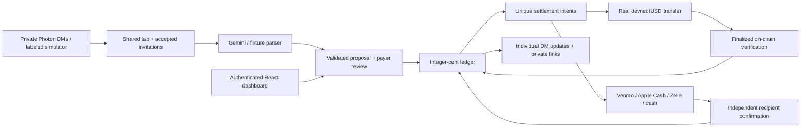

# Tab

Shared expenses coordinated through private iMessage conversations, with a deterministic ledger and a choice of payment methods. HackNC 2026 MVP. Participants need no crypto wallet to join, propose expenses, or use manual settlement.

Tab uses Bun, strict TypeScript, Hono, SQLite/Drizzle, React/Vite, Photon Spectrum, Gemini, and Solana. Read [the authoritative product specification](Tab_Astra_One_Shot_Build_Prompt.md), [architecture](docs/ARCHITECTURE.md), [decisions](docs/ADR.md), and [payment adapter contract](docs/PAYMENT_RAILS.md).



## Run locally

Install Bun 1.3 or newer using the [official Bun installation instructions](https://bun.sh/docs/installation), then:

```sh
bun install
test -f .env || cp .env.example .env
bun run db:migrate
bun run seed:demo
bun run dev
```

Open **http://localhost:5173**. Choose **Explore as Alex**. API: http://127.0.0.1:3000. Local demo identity switching is explicitly simulated and the server refuses a non-loopback bind while `DEMO_MODE=true`. The default local experience requires no credentials or external accounts.

For a single server serving the built UI:

```sh
bun run build
APP_BASE_URL=http://localhost:3000 bun run start
```

Use http://localhost:3000 (the URL must match `APP_BASE_URL` exactly for CSRF protection). SQLite, private images, session records, and encrypted test keys live in `.data/`. Keep this directory on a persistent volume. `seed:demo` is idempotent and does not clear data. **Start fresh scenario** creates a new trip and preserves prior history.

```sh
bun run typecheck
bun test
bun run build
bun run demo:smoke
bun run format:check
```

`demo:smoke` runs in an isolated in-memory database and prints **OFFLINE SIMULATION**. It exercises the actual verifier using mocked RPC data; it does not submit any real Solana transaction. There is no lint command configured; strict TypeScript and tests are the executable code checks.

## Deploy now

Use one Railway service with the root `Dockerfile`, the included `railway.json`, a persistent volume at `/app/.data`, and serverless sleeping disabled. The API also serves the built frontend. Configure credentials in Railway runtime variables, set `DEMO_MODE=false`, and use the public HTTPS domain for `APP_BASE_URL`. Deploy the repository root; `server/hellio` is a separate echo app. Follow [the exact Railway deployment steps](docs/DEPLOY_RAILWAY.md), including the single-listener cutover and fresh-database versus data-migration choice.

## What is implemented versus simulated

| Component | Implementation | Default local mode |
| --- | --- | --- |
| Accounting, splits, plans, confirmations | Real SQLite transactions, exact integer cents, audit + outbox | Working |
| React dashboard and private API | Session cookie, CSRF and membership checks | Seeded identities simulated |
| Photon Spectrum | Private DM router, logical shared tabs, invitations, individual updates + DM auth | Local simulator works; credentials authenticate, live round trip still unverified |
| Gemini | SDK structured JSON + Zod validation, receipts/text/classification | Constrained text parser and explicit dinner/screenshot fixtures |
| Solana | Real SPL `transferChecked`, encrypted lazy wallets, persisted signed bytes, finalized verifier and reconciliation | Unavailable until devnet setup; preview cannot credit ledger |
| Venmo / Apple Cash / Zelle / cash | Shared manual rail, recipient-supplied destination, sender claim, independent recipient confirmation | Fully usable workflow; seeded demonstration claims are simulation |

No personal payment-provider execution or verification API is invented. No screenshot is accepted as proof of settlement. A sender claim never changes a balance. A generic chat `PAY` or `YES` cannot move tokens. Private messages and provider APIs are not called unless explicitly enabled in configuration.

## Solana devnet setup

Solana is the primary executable payment rail. **TAB Test USD (tUSD)** is a custom six-decimal devnet token with **no real value**. It is not USDC. Mainnet configuration is rejected.

1. Run `bun run setup:devnet`. It creates a protected local treasury key file if needed, checks the devnet genesis hash, requests devnet SOL if needed, and creates or reuses a stable treasury-owned mint. Public mint metadata is saved in `.data/devnet.json`. No signing key is printed.
2. If the public faucet is unavailable or rate limited, fund the printed **public treasury address** with devnet SOL using the [Solana faucet](https://faucet.solana.com/), or use a funded dedicated devnet treasury via `TREASURY_KEY_PATH`. Rerun setup. Roughly 0.05 devnet SOL covers a small demonstration; network costs can change.
3. Set `DEMO_CUSTODIAL_WALLETS=true` and `WALLET_ENC_KEY` to the output of `openssl rand -hex 32` in `.env`. Keep that key stable and secret. `TAB_TEST_TOKEN_MINT` is optional when `.data/devnet.json` exists. Restart the server.
4. As Alex and Ben separately, use **Payment details → Enable my test wallet**. No other participant needs a wallet. Empty enabled wallets receive 1,000 fake tUSD. Funding is rate limited; the treasury sponsors account and transfer fees.
5. As Ben choose Solana for the exact pending $30 obligation, then review and explicitly authorize it. Wait for **On-chain verified · devnet**. The explorer link points to the actual signature on devnet.

`bun run demo:devnet` runs the explicit local CLI variant: a fresh group, actual $30 devnet tUSD transfer and verifier, followed by two clearly simulated manual confirmations. It is not run implicitly by server startup. The CLI prints a successful transaction link only after real finalized verification.

Transfers convert cents using `BigInt(cents) * 10_000n`. Each approval binds payer, recipient, amount and unique attempt; tokens expire and are single-use. Signed bytes are durable before broadcast. RPC timeouts remain unresolved; the reconciler checks/rebroadcasts only the same transaction. A missing expired signature remains locked for investigation instead of risking a second payment.

## Photon / iMessage and Gemini setup

The primary experience is now **private DMs + shared invitations**, following the user's revised scope. It does not require an iMessage group or Photon Business. Read [the complete current test guide](docs/DIRECT_MESSAGE_DEMO.md).

1. Set `PHOTON_PROJECT_ID`, `PHOTON_PROJECT_SECRET`, and `PHOTON_ENABLED=true` in the ignored root `.env`. The supplied project already authenticates and its iMessage provider is enabled. `bun run check:photon` verifies authentication/token issuance without sending messages.
2. Register each tester's actual iMessage number/email under **Photon → Users**. Shared accounts can only message registered recipients ([Photon guidance](https://photon.codes/docs/spectrum-ts/troubleshooting/imessage)). Each tester uses their assigned direct conversation; sender numbers can differ between people. Tab does not create native iMessage groups ([line model](https://photon.codes/docs/spectrum-ts/providers/imessage/connection-and-routing)).
3. Run `bun run dev`. Privately message `ping`, `name Alex`, then `create Tahoe`. `@tab` is optional in DMs. Send `invite` and share the returned invitation with friends. They text `join <code>` to their own Tab conversation, or accept in an authenticated browser. A shareable invite grants membership after explicit acceptance; a private sign-in link authenticates only its intended identity and must never be shared.
4. Once friends have joined, send `I paid $120 for groceries, split with everyone`, or send a receipt photo. Review and confirm the proposed amount, payer and participants. Confirmation queues a separate message to each included participant with their exact share and a private, five-minute sign-in link. An expense is not a payment request until a settlement plan is created; nothing moves money automatically.
5. Use `link` for the private browser dashboard. Use `tabs` and `use <tab-id>` when participating in multiple tabs. `STOP` pauses all automatic updates; `START` resumes future updates. `revoke invites` disables outstanding invite links for the organizer's active tab. Invites last seven days. No wallet is needed for joining or manual payment methods.

The adapter uses `spectrum-ts` 12.10.1 with an async message stream, observed sender identities, private `space.create`, and bounded attachment reads. It ignores outbound messages and native groups. SDK initialization is labeled **Photon awaiting message** until an inbound request arrives. It uses the SDK's resumable stream and token renewal; a terminal stream failure disables real DM login. Run one active listener per project. Notifications have individual durable outbox rows and capped retries; one failed recipient does not resend everyone else's update. A process crash after provider acceptance can still duplicate a notification. Money-related mutations remain idempotent.

`APP_BASE_URL=http://localhost:5173` only opens on this Mac. For phone links, deploy the built app with a reachable HTTPS URL, `DEMO_MODE=false`, a 32+ character `SESSION_SECRET`, and persistent SQLite storage. Photon messaging itself connects outbound and needs no webhook tunnel. Do not expose the identity-switching demo server publicly.

For actual receipt OCR and flexible language parsing, set **`GEMINI_API_KEY_FILE` and `GEMINI_MODEL`** (or use `GEMINI_API_KEY` from your deployment secret manager) to a model available in your account that supports structured output ([Gemini documentation](https://ai.google.dev/gemini-api/docs/structured-output)). Without them, typed expense examples use the labeled constrained parser; real receipt images report that Gemini is required. The demo receipt buttons remain explicit fixtures. Gemini cannot calculate trusted balances, invent members, authorize payments or verify screenshots.

Commands: `help`, `ping`, `name Alex`, `create Tahoe`, `invite`, `join <code>`, `tabs`, `use <tab-id>`, `link`, `I paid $120 for groceries, split with everyone`, `balances`, `expenses`, `settle`, `confirm <expense-id>`, `reject <expense-id>`, `change <expense-id> dinner $84`, `STOP`, `START`, `revoke invites`. Caption receipts `split this with everyone` only if everyone is intended; otherwise review participants privately. Receipt authorship does not prove who paid. Unknown people are not silently added or charged. Joining later does not alter earlier splits.

Local secret storage: the Gemini credential is in `~/.config/tab/gemini-api-key`, outside the repository, with file mode `0600` and directory mode `0700`. The ignored `.env` contains only the absolute `GEMINI_API_KEY_FILE` path and `GEMINI_MODEL=gemini-2.5-flash`. The server reads the file without exporting its contents to child processes or the frontend. Configure only one key source. A live synthetic $120/two-person expense successfully passed Gemini structured extraction and backend validation. Real receipt-image OCR remains separately unverified.

## Mixed-payment walkthrough

See [the complete demo script](docs/DEMO_SCRIPT.md). In brief:

1. Alex proposes and confirms $120 groceries shared by four. Alex +$90; Ben, Casey and Drew −$30 each.
2. Save a settlement plan. Ben authorizes an actual devnet tUSD payment if configured; the exact finalized transfer credits $30 once.
3. Casey chooses Venmo, independently pays, and claims it. Balance remains −$30 until Alex confirms receipt in a separate authenticated session.
4. Drew follows the Apple Cash, Zelle or cash instructions and the same independent recipient confirmation process.
5. All balances are zero, with distinct **on-chain verified** and **confirmed by recipient** provenance. Screenshots never count as provider verification.

Without devnet, use a recipient-confirmed cash payment for Ben to finish the browser demonstration. The offline smoke script also exercises the entire mixed rail accounting flow against a labeled RPC fixture. Neither path fabricates a live chain success.

## Limits and troubleshooting

- This is a single-server hackathon MVP, not production custody or a real-money service. Production needs noncustodial authorization, real provider review, account recovery, operational monitoring and an independent security review.
- USD only, maximum $10,000 per expense/intent validation, full settlement amounts only. Greedy netting is deterministic and feasible, not guaranteed globally minimal.
- Active plans freeze new expense confirmations. Resolve them or cancel untouched attempts as owner. Submitted, claimed or disputed payments cannot be cancelled blindly. Dispute resolution and financial corrections require a reviewed follow-up implementation; confirmed expenses cannot be silently edited.
- Payment details are self-attested by the recipient, never provider-verified. No bank credentials, automatic payment links, unofficial QR codes, Apple Pay/Apple Cash conflation or mainnet fallback.
- Receipt images: PNG/JPEG/WebP, maximum 4 MB, MIME signature checks, private authenticated access, seven-day byte retention. Database backups must follow the same retention policy. Fine-grained item claims and malware/image re-encoding are deferred.
- Membership is checked on every private group request. Real and demo scopes cannot be mixed. Demo identity switching is not an authentication model for deployment.
- Notifications use an outbox and capped exponential retries. A crash after remote delivery but before recording success can duplicate a notification; ledger operations remain idempotent. There are no automatic reminders; reminder preferences default off. Accepted tab membership enables purchase updates, which STOP can pause.
- `CSRF` errors usually mean the browser URL differs from `APP_BASE_URL`. Vite expects port 5173; built single-server mode expects port 3000 after updating the variable.
- A missing destination means the **recipient** must save their own handle/contact, or the sender should choose cash. No data is copied from chat contacts.
- `PLAN_ACTIVE`: finish/cancel the previous plan before confirming another expense. `submitted`: reconciliation checks the existing signature; do not recreate the transfer.
- `WALLET_ENC_KEY` changes make existing encrypted keys unreadable. Back it up securely. Never commit `.env`, `.data`, database files, or treasury keys.

## Repository map

```text
server/src/
  ai/          structured extraction, validation and explicit fixtures
  api/         Hono routes, private assets and browser security
  db/          Drizzle schema, migrations, seed and SQLite client
  domain/      integer money, splitting, balances and netting
  jobs/        reconciliation and notification outbox
  messaging/   Photon adapter and idempotent command router
  payments/    provider contract, registry/service and manual/Solana rails
  security/    hashed one-time challenges and opaque sessions
  solana/      AES-GCM wallet storage and exact RPC verification
  test/        domain, state-machine, HTTP and mocked RPC tests
web/src/       responsive React dashboard and payment workflows
scripts/       dev, migration, seed, smoke and devnet commands
docs/          architecture, decisions, phases, payment rails and demo
```

## Browser verification

With `bun run dev` running, execute `bun run test:browser` and `bun run test:browser:dm`. The second test exercises organizer creation, invite acceptance in another browser session, private expense shares and STOP. It uses a clean headless Chrome context, creates a fresh demo trip, and checks desktop plus a 390px mobile viewport. Set `CHROME_PATH` if Chrome is not installed at the default macOS path. No browser installation is automatic. Screenshots go to ignored `.data/screenshots/`. See [recorded verification results](docs/TEST_RESULTS.md).
