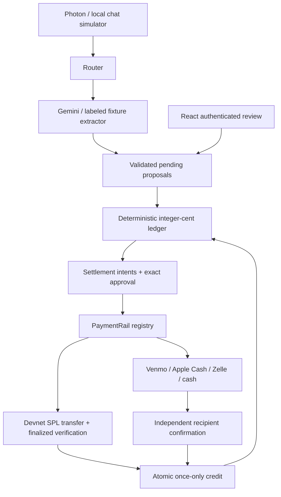

# Tab architecture — refined design

Photon iMessage or the explicitly labeled simulator feeds a command router. Gemini proposes JSON; Zod and deterministic domain services validate it. The private React UI talks to a Hono API over same-origin HttpOnly sessions. SQLite with Drizzle stores expenses, immutable payment intentions, attempts, private assets, audit, and an outbox.

First refinement (product): members exist without wallets; only Solana selection provisions encrypted demo wallets. No provider APIs invented. Photos never establish payer or settlement. Mock and live integration modes are independent and visible.

Second refinement (correctness): single durable server, synchronous SQLite transactions, one live attempt per intent, no partial payments. An active plan freezes confirmation of new expenses until settled or safely cancelled. Read-only previews never reserve debt; saved plans do. Each Solana authorization binds actor, attempt, amount, recipient, and expiring one-time token. Signed bytes/signature are durable before broadcast. Reconciliation only rebroadcasts identical bytes; ambiguous submissions stay locked. Only recipient confirmation or finalized exact token movement contributes to the balance query. Simulated chain results never credit the real ledger.

Private assets are capped, content-sniffed, retained seven days, and membership checked. Browser mutations require an exact Origin and JSON/custom header; sessions are HttpOnly, SameSite Strict, Secure on HTTPS. Real login challenges travel only over verified provider DMs. Demo identity switching is restricted to mock groups and loopback-hosted demo mode.

## Private-DM revision

The user's shared-plan constraint replaces native iMessage groups with logical tabs. Each provider-observed identity has an explicit active-tab context. Organizer-created, hashed, expiring/revocable invitation codes are accepted by an authenticated browser or verified inbound DM. Invitations grant shared history access only after explicit acceptance. Arbitrary names/numbers are never enrolled by an AI result.

Confirmed expenses enqueue one row per included member with their exact share; settlement plans enqueue payer-specific requests, and sender claims notify their actual recipient. Command replies stay in the originating private conversation. Outbox reads are recipient-filtered; delivery resolves a verified Photon identity and creates a one-person DM. Fresh single-use sign-in links are minted at delivery, never stored in notification rows. The single-process flush guard prevents overlapping drains; retry/backoff is per recipient. STOP suppresses queued and future updates globally for that identity. Replay deduplication protects mutations; delivery is at-least-once across process crashes. Native groups are ignored.

New persistent tables: tab_invites, dm_contexts, dm_preferences and dm_requests; outbox gains recipient_user_id. Migration 0001 preserves existing ledger data. The local browser simulator uses the same direct-tab service with mock identities and cannot reach live Photon recipients.
